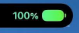

<div align="center">

# ⚡ Power-Up

**A seamless, phone-style charging pill indicator for [Dux Modular Shell (DMS)](https://github.com/duxlabs-dev/dux-shell).**

[](LICENSE)
[](https://github.com/duxlabs-dev/dux-shell)
[]()

<br/>

<p align="center">
  
</p>

*Appears smoothly inside your main top bar pill only when plugged in and charging.*

</div>

---

## 🌟 Highlights

- **Embedded directly in your main pill**: Sits cleanly next to the time and date (`7:28 PM • Thu 5 • [ 99% ⚡ ]`) rather than creating an awkward detached secondary pill.
- **iOS / Phone-Style Capsule**: Crisp rounded battery shape with a translucent green border and an animated charge fill that tracks real-time capacity.
- **Two-Tone Inverse Color Reveal**: Digits and lightning bolt remain bright white against the empty track, seamlessly inverting to black as the green charge level advances across them.
- **Smart Visibility**: Completely invisible when running on battery. Smoothly slides in when AC power is connected and charging begins.
- **Battery & Resource Friendly**: Powered directly by native `BatteryService` (UPower DBus events). No CPU-heavy shell polling loops; animations automatically pause when screen is idle or if Reduced Motion is enabled.

---

## 🚀 Quick Install (Single Command)

Run this command in your terminal to automatically clone the DMS UI components, apply the patch, and reload your shell:

```bash
curl -fsSL https://raw.githubusercontent.com/meet-afk/Power-up/main/install.sh | bash
```

Once installed, **plug in your charger** and watch your clock pill expand with the charging animation!

---

## 🛠 Manual Installation

If you prefer to inspect and install manually:

```bash
# 1. Clone the repository
git clone https://github.com/meet-afk/Power-up.git
cd Power-up

# 2. Make the installer executable and run it
chmod +x install.sh
./install.sh
```

---

## 🔄 Uninstallation

To revert back to the stock DMS clock pill:

```bash
curl -fsSL https://raw.githubusercontent.com/meet-afk/Power-up/main/uninstall.sh | bash
```

*(Or run `./uninstall.sh` from the cloned repository).*

---

## ⚙️ How It Works Behind the Scenes

DMS compiles its default QML UI directly into the Go executable, but natively supports overriding the UI via the `DMS_SHELL_DIR` environment variable.

The installer:
1. Clones the official `dux-shell` repository into `~/repos/dux-shell` (if not already present).
2. Applies `charging-battery.patch` to `quickshell/Widgets/ClockContent.qml`.
3. Sets up a user systemd override in `~/.config/systemd/user/dms.service.d/override.conf`:
   ```ini
   [Service]
   Environment="DMS_SHELL_DIR=/home/<user>/repos/dux-shell/quickshell"
   ```
4. Reloads the user systemd daemon and restarts `dms.service`.

---

## 📄 License

Distributed under the [MIT License](LICENSE).
# Power-Sense
